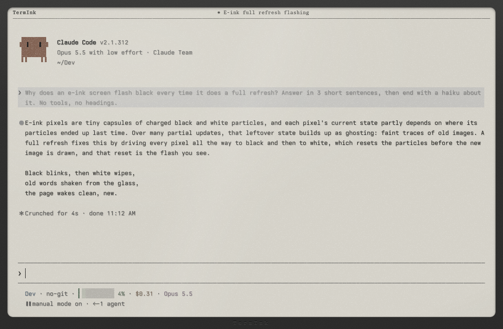

# TermInk

A terminal that looks and behaves like an e-ink reader, on your Mac's screen.



| E-ink (Carta grey) | Kaleido (color) |
| --- | --- |
|  |  |

## Why TermInk

- **Calm and easy on the eyes.** Dark text on a pale, paper-like page, with soft grain instead of a glowing black rectangle.
- **A focused feel.** Output arrives at a slow, steady panel pace, and the window is a quiet sheet in a bezel. It is a good place to read logs, diffs and long answers.
- **A real terminal underneath.** Your shell, your tools, and full-screen apps such as Claude Code, vim and htop run as they always do.
- **Made readable on a light page.** Programs written for dark terminals get their colors remapped, so nothing disappears into the paper.

TermInk only imitates e-ink on a normal display. It does not drive real e-ink hardware. It runs on macOS only.

## Features

- **Two panel types.** Carta grey is a 16-level grey ramp from pigment black to an unlit page. Kaleido color uses a muted palette, like a color e-ink screen. Switch with Cmd + Shift + K.
- **Page turns instead of scrolling.** The mouse wheel turns one page per flick through your history. Full-screen apps keep the wheel for themselves.
- **Refresh flashes and ghosting.** Changed lines flash and settle in steps, big redraws leave faint ghosts, and a full refresh wipes them every few pages. You choose the refresh speed, the ghosting and how often a full refresh happens.
- **No flashing while you work.** Typing echoes at once, and live apps such as Claude Code repaint without flashing the screen on every update.
- **Front light.** Add a cool or warm glow over the page. Cmd + Shift + L cycles off, cool and warm.
- **A bezel.** Frame the screen with an adjustable bezel, an optional chin, a wordmark and rounded screen corners. A title bar can show the window title, clock and battery, and an optional footer shows a page number and progress line.
- **Sleep.** After the window has been unfocused for a while, the panel goes to a held sleep screen. Click to wake it. The delay is adjustable, or you can turn it off.
- **Ink texture.** Grain and slightly eaten glyph edges make text look printed. Turn it up, down or off.
- **18 bundled fonts.** Including OpenDyslexic Mono and Illinois Mono for easier reading, plus Monaspace, JetBrains Mono, Fira Code and more. Each is previewed in its own face in the picker.
- **Code-friendly output.** Optional line numbers (absolute or relative), and optional highlighting of URLs, paths, numbers, errors and typed commands. Highlights use weight and style, so they still read in grey. Highlighting needs zsh.
- **E-ink mouse cursors.** An ink block or I-beam that snaps to the character grid, or the normal system pointer.
- **A settings drawer.** Press Cmd + , for tabs (Text, Screen, Device, Terminal) that change everything live. Settings are remembered between sessions.
- **A Dock icon that follows the panel.** Choose a bezel or plain icon; it changes with grey and color mode.

### Keys

| Keys | Action |
| --- | --- |
| Cmd + `+` / `-` / `0` | Font size (0 resets) |
| Cmd + Shift + K | Toggle Kaleido color |
| Cmd + Shift + L | Cycle the front light |
| Cmd + `,` | Settings |

## For developers

TermInk is built with Tauri v2 and the xterm.js DOM renderer, so text stays real text and every effect is CSS over it.

### Build and run

You need macOS, [Rust](https://rustup.rs), Node.js and [pnpm](https://pnpm.io). Xcode is only needed to rebuild the app icon.

```sh
pnpm install
pnpm tauri dev      # dev server on port 1440
pnpm build          # type-check and build the web part into dist/
```

Releases are source only for now: bundling is off (`bundle.active` is `false` in `src-tauri/tauri.conf.json`), so there are no signed binaries.

### Settings file

Settings are saved to `~/Library/Application Support/dev.reishi.termink/prefs.json`. Only values that differ from the defaults are stored.

### App icon

The icon art is rendered from the app's own CSS with headless Chrome. Edit `tools/icon/icon.html`, run `tools/icon/render.sh`, copy the chosen art to `src-tauri/TermInk.icon/Assets/art.png`, then run `tools/build_icon.sh`.

### Licenses

TermInk is MIT licensed, see [LICENSE](LICENSE). Bundled fonts are under the SIL Open Font License 1.1, except OpenDyslexic Mono (Bitstream Vera + CC BY 3.0) and Comic Mono (MIT), see [public/fonts/LICENSES.md](public/fonts/LICENSES.md).

Copyright (c) 2026 Reishi.dev. A Reishi.dev project.
