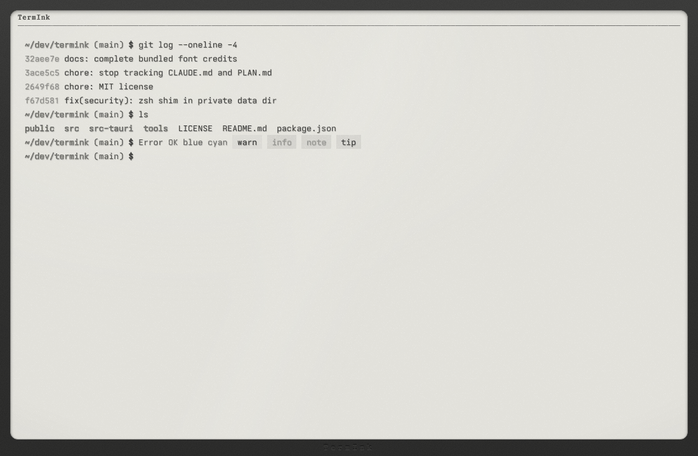
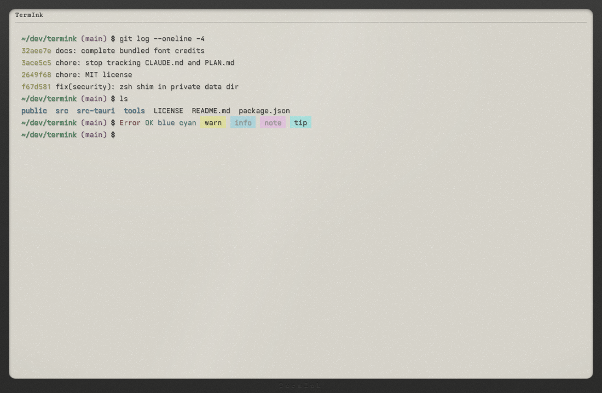
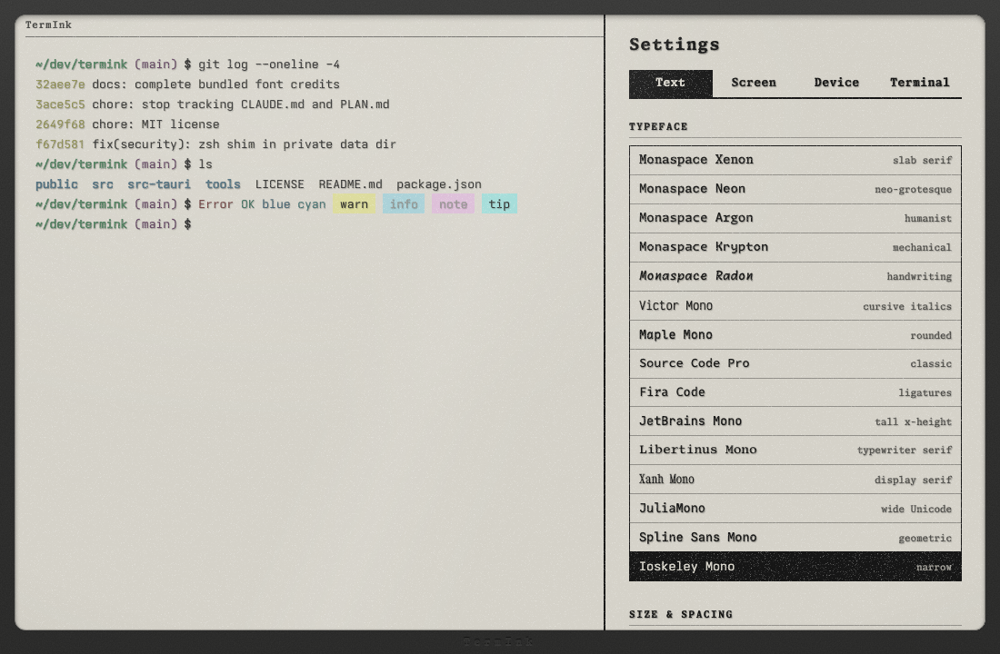

# TermInk

A terminal emulator that behaves like an e-ink reader panel. Built with Tauri v2 and the xterm.js DOM renderer. macOS only for now.

| E-ink (Carta grey) | Kaleido (color) |
| --- | --- |
|  |  |



## What it does

- **Panel look:** a 16-level grey ramp from pigment black to an unlit page. App colors are quantized into it. Kaleido mode uses a muted 4096-color palette instead.
- **Panel behavior:** output is drawn at a panel frame rate. Small changes draw in place, larger ones settle through grey steps or an inverted flash with ghosting, with a full refresh every N. Output floods use a fast black-and-white (A2) waveform. A held sleep screen appears when the window is unfocused.
- **Real text:** the DOM renderer keeps glyphs as real text, so every effect is CSS over them, including an ink texture.
- **Cursors:** a grid-snapping block mouse cursor that matches the text cursor.
- **Bezel and Dock icon:** an optional bezel, and a Dock icon (bezel or plain) that follows the panel mode.
- **Settings:** a drawer with Text, Screen, Device and Terminal tabs. 18 bundled monospace fonts, including OpenDyslexic Mono and Illinois Mono for easier reading.
- **Shell integration (zsh):** OSC 133 prompt marks drive the input ink.

## Keys

| Keys | Action |
| --- | --- |
| Cmd + `+` / `-` / `0` | Font size |
| Cmd + Shift + K | Toggle Kaleido color |
| Cmd + Shift + L | Cycle the front light (off, cool, warm) |
| Cmd + `,` | Settings |

## Build and run

You need macOS, [Rust](https://rustup.rs), Node.js and [pnpm](https://pnpm.io). Xcode is only needed to rebuild the app icon.

```sh
pnpm install
pnpm tauri dev      # dev server on port 1440
pnpm build          # type-check and build the web part into dist/
```

Releases are source only for now: bundling is off (`bundle.active` is `false` in `src-tauri/tauri.conf.json`), so there are no signed binaries.

## Settings file

Settings are saved to `~/Library/Application Support/dev.reishi.termink/prefs.json`. Only values that differ from the defaults are stored.

## App icon

The icon art is rendered from the app's own CSS with headless Chrome. Edit `tools/icon/icon.html`, run `tools/icon/render.sh`, copy the chosen art to `src-tauri/TermInk.icon/Assets/art.png`, then run `tools/build_icon.sh`.

## Licenses

TermInk is MIT licensed, see [LICENSE](LICENSE). Bundled fonts are under the SIL Open Font License 1.1, except OpenDyslexic Mono (Bitstream Vera + CC BY 3.0) and Comic Mono (MIT), see [public/fonts/LICENSES.md](public/fonts/LICENSES.md).

A Reishi.dev project.
